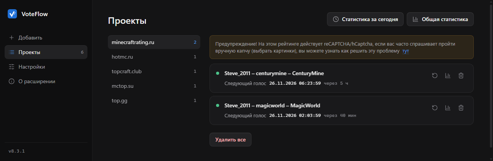
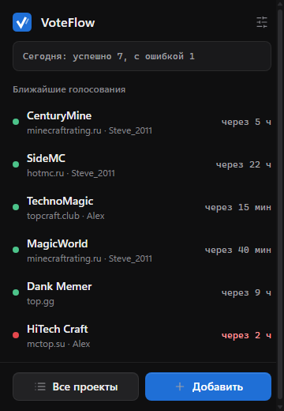

<div align="center">


# VoteFlow

**Расширение для браузера, которое само голосует за ваши игровые серверы на сайтах-рейтингах и забирает ежедневные награды**

[](https://github.com/BazZziliuS/VoteFlow/releases/latest)
[](https://github.com/BazZziliuS/VoteFlow/actions/workflows/check.yml)
[](https://github.com/BazZziliuS/VoteFlow/releases)
[](LICENSE)
<br>


[Скачать](https://github.com/BazZziliuS/VoteFlow/releases/latest) · [Установка](#установка) · [Поддерживаемые сайты](#поддерживаемые-сайты) · [Сообщить о проблеме](https://github.com/BazZziliuS/VoteFlow/issues/new)

</div>

<p align="center">
  
  &nbsp;
  
</p>

## Возможности

- **Голосует по расписанию.** Добавьте ссылку на свой сервер на сайте-рейтинге — VoteFlow запомнит время сброса голосов и будет голосовать сам, даже когда вы о нём забыли
- **Помогает с капчами.** reCAPTCHA, hCaptcha, Yandex SmartCaptcha (включая слайдер), Cloudflare Turnstile и MTCaptcha. Если капчу нельзя пройти автоматически, придёт уведомление
- **Входит в аккаунты.** Steam и ВКонтакте / VK ID — если вы уже вошли в них в этом браузере
- **Тихий режим.** На части сайтов голосует в фоне, не открывая вкладки
- **Видно всё сразу.** По клику на иконку — ближайшие голосования, статус каждого проекта и статистика за день; число ошибок — прямо на иконке
- **Сообщает о проблемах.** У проекта с ошибкой есть кнопка «Сообщить о проблеме» с уже заполненной заявкой
- **Само предлагает обновиться**, когда выходит новая версия

## Установка

1. Скачайте `VoteFlow-<версия>.zip` из [последнего релиза](https://github.com/BazZziliuS/VoteFlow/releases/latest) и распакуйте
2. Откройте страницу расширений своего браузера (адреса — в таблице ниже) и включите **режим разработчика**
3. Нажмите **«Загрузить распакованное расширение»** и выберите папку `VoteFlow`

**Обновление:** замените содержимое папки и нажмите «Обновить» на странице расширений — проекты и настройки сохранятся.

> [!IMPORTANT]
> **Переход с Auto Vote Rating или VoteFlow 8.x.** С версии 9.0 VoteFlow — отдельное расширение со своим ID, поэтому данные старого не подхватываются автоматически:
> 1. В старом расширении: **Настройки → Экспортировать настройки** (сохранится файл `.json`)
> 2. Удалите старое расширение — иначе оба будут голосовать одновременно
> 3. Установите VoteFlow и в нём: **Настройки → Импортировать настройки**, выберите сохранённый файл

### Браузеры

Нужен браузер на Chromium версии 105 или новее.

| Браузер | Страница расширений | Проверено |
| --- | --- | --- |
| Google Chrome | `chrome://extensions/` | через Chromium 159 |
| Microsoft Edge | `edge://extensions/` | Edge 158 |
| Brave | `brave://extensions/` | — |
| Opera, Opera GX | `opera://extensions/` | ограниченный режим, см. ниже |
| Яндекс Браузер | `browser://extensions/` | — |
| Vivaldi | `vivaldi://extensions/` | — |

> [!NOTE]
> В Opera VoteFlow работает в ограниченном режиме: нет групп вкладок, нет доступа к кадрам Google reCAPTCHA и нет работы в фоне, когда закрыты все вкладки. Расширение объясняет это при первом запуске. Firefox не поддерживается.

> [!WARNING]
> VoteFlow не опубликован в магазинах расширений. Публикации с названием Auto Vote Rating в Chrome Web Store и Edge Add-ons — это старое оригинальное расширение, а не VoteFlow.

## Как пользоваться

1. Откройте страницу своего сервера на сайте-рейтинге и нажмите на иконку VoteFlow — расширение предложит добавить проект. Или вставьте ссылку вручную на вкладке **«Добавить»**
2. Укажите ник и один раз разрешите доступ к сайту
3. Дальше VoteFlow голосует сам. Время следующего голоса видно на вкладке **«Проекты»** и в окне расширения

Ссылка нужна на страницу сервера **на сайте-рейтинге**, а не на сайт самого сервера. Расширение подсказывает это ещё до нажатия «Добавить».

## Поддерживаемые сайты

<details>
<summary>147 сайтов — показать список</summary>

| | | | |
| --- | --- | --- | --- |
| [16bitmc.net](https://16bitmc.net/) | [liste-serveurs.fr](https://liste-serveurs.fr/) | [minecraftserver.sk](https://minecraftserver.sk/) | [serveur-prive.net](https://serveur-prive.net/) |
| [40servidoresmc.es](https://40servidoresmc.es/) | [listforge.net](https://listforge.net/) | [minecraftserverlijst.nl](https://minecraftserverlijst.nl/) | [serveurliste.com](https://serveurliste.com/) |
| [ark-servers.net](https://ark-servers.net/) | [loliland.net](https://loliland.net/) | [minecraftserverlist.eu](https://minecraftserverlist.eu/) | [serveurs-mc.net](https://serveurs-mc.net/) |
| [arma3-servers.net](https://arma3-servers.net/) | [loliland.ru](https://loliland.ru/) | [minecraftservers.biz](https://minecraftservers.biz/) | [serveursminecraft.org](https://serveursminecraft.org/) |
| [atlas-servers.io](https://atlas-servers.io/) | [magicrust.gg](https://magicrust.gg/) | [minecraftservers.org](https://minecraftservers.org/) | [servidoresdeminecraft.es](https://servidoresdeminecraft.es/) |
| [atlauncher.com](https://atlauncher.com/) | [mc-liste.de](https://mc-liste.de/) | [minecraftservers100.com](https://minecraftservers100.com/) | [space-engineers.com](https://space-engineers.com/) |
| [attackofthebteamservers.com](https://attackofthebteamservers.com/) | [mc-lists.org](https://mc-lists.org/) | [minecraftservery.eu](https://minecraftservery.eu/) | [squad-servers.com](https://squad-servers.com/) |
| [best-minecraft-servers.co](https://best-minecraft-servers.co/) | [mc-servers.com](https://mc-servers.com/) | [minecraftsurvivalservers.com](https://minecraftsurvivalservers.com/) | [starbound-servers.net](https://starbound-servers.net/) |
| [bestservers.com](https://bestservers.com/) | [mclike.com](https://mclike.com/) | [minecraftsurvivalservers.net](https://minecraftsurvivalservers.net/) | [teamspeak-servers.org](https://teamspeak-servers.org/) |
| [bloodrust.com](https://bloodrust.com/) | [mclist.io](https://mclist.io/) | [minehut.com](https://minehut.com/) | [technicservers.com](https://technicservers.com/) |
| [botlist.me](https://botlist.me/) | [mcrate.su](https://mcrate.su/) | [minelist.net](https://minelist.net/) | [tekkitserverlist.com](https://tekkitserverlist.com/) |
| [conan-exiles.com](https://conan-exiles.com/) | [mcserver-list.eu](https://mcserver-list.eu/) | [minerank.com](https://minerank.com/) | [terraria-servers.com](https://terraria-servers.com/) |
| [counter-strike-servers.net](https://counter-strike-servers.net/) | [mcservers.top](https://mcservers.top/) | [mineserv.top](https://mineserv.top/) | [tf2-servers.com](https://tf2-servers.com/) |
| [craftbook.cz](https://craftbook.cz/) | [mcservertime.com](https://mcservertime.com/) | [mineservers.com](https://mineservers.com/) | [tmonitoring.com](https://tmonitoring.com/) |
| [craftlist.org](https://craftlist.org/) | [mcservidores.com](https://mcservidores.com/) | [minestatus.net](https://minestatus.net/) | [top-games.net](https://top-games.net/) |
| [cubeworld-servers.com](https://cubeworld-servers.com/) | [mctop.su](https://mctop.su/) | [miscreated-servers.com](https://miscreated-servers.com/) | [top-mc-servers.net](https://top-mc-servers.net/) |
| [curseforge.com](https://curseforge.com/) | [minebrowse.com](https://minebrowse.com/) | [misterlauncher.org](https://misterlauncher.org/) | [top-mmogames.ru](https://top-mmogames.ru/) |
| [czech-craft.eu](https://czech-craft.eu/) | [minecraft-list.cz](https://minecraft-list.cz/) | [mmorpg.top](https://mmorpg.top/) | [top-serveurs.net](https://top-serveurs.net/) |
| [dayz-servers.org](https://dayz-servers.org/) | [minecraft-mp.com](https://minecraft-mp.com/) | [mmotop.ru](https://mmotop.ru/) | [top.gg](https://top.gg/) |
| [discadia.com](https://discadia.com/) | [minecraft-news.net](https://minecraft-news.net/) | [mmovote.ru](https://mmovote.ru/) | [top100arena.com](https://top100arena.com/) |
| [discordbotlist.com](https://discordbotlist.com/) | [minecraft-server-list.com](https://minecraft-server-list.com/) | [monitoringminecraft.ru](https://monitoringminecraft.ru/) | [topcraft.club](https://topcraft.club/) |
| [discords.com](https://discords.com/) | [minecraft-server.eu](https://minecraft-server.eu/) | [pixelmon-server-list.com](https://pixelmon-server-list.com/) | [topcraft.ru](https://topcraft.ru/) |
| [ecoservers.io](https://ecoservers.io/) | [minecraft-serverlist.com](https://minecraft-serverlist.com/) | [pixelmonservers.com](https://pixelmonservers.com/) | [topeaglerservers.com](https://topeaglerservers.com/) |
| [emeraldservers.com](https://emeraldservers.com/) | [minecraft-serverlist.net](https://minecraft-serverlist.net/) | [planetminecraft.com](https://planetminecraft.com/) | [topg.org](https://topg.org/) |
| [empyrion-servers.com](https://empyrion-servers.com/) | [minecraft-servers-list.org](https://minecraft-servers-list.org/) | [play-minecraft-servers.com](https://play-minecraft-servers.com/) | [topmcservers.com](https://topmcservers.com/) |
| [findmcserver.com](https://findmcserver.com/) | [minecraft-servers.de](https://minecraft-servers.de/) | [reign-of-kings.net](https://reign-of-kings.net/) | [topminecraftservers.org](https://topminecraftservers.org/) |
| [ftbservers.com](https://ftbservers.com/) | [minecraft-servers.ru](https://minecraft-servers.ru/) | [rovelstars.com](https://rovelstars.com/) | [topservers.com](https://topservers.com/) |
| [gmod-servers.com](https://gmod-servers.com/) | [minecraft-tracker.com](https://minecraft-tracker.com/) | [rpg-paradize.com](https://rpg-paradize.com/) | [trackyserver.com](https://trackyserver.com/) |
| [gtop100.com](https://gtop100.com/) | [minecraft.buzz](https://minecraft.buzz/) | [rust-servers.net](https://rust-servers.net/) | [unturned-servers.net](https://unturned-servers.net/) |
| [hotmc.ru](https://hotmc.ru/) | [minecraft.global](https://minecraft.global/) | [serverlist.games](https://serverlist.games/) | [valheim-servers.io](https://valheim-servers.io/) |
| [hoyolab.com](https://hoyolab.com/) | [minecraft.menu](https://minecraft.menu/) | [serverlist101.com](https://serverlist101.com/) | [voxelrank.com](https://voxelrank.com/) |
| [hurtworld-servers.net](https://hurtworld-servers.net/) | [minecraftbestservers.com](https://minecraftbestservers.com/) | [serverliste.net](https://serverliste.net/) | [vrising-servers.net](https://vrising-servers.net/) |
| [hytale-servers.io](https://hytale-servers.io/) | [minecraftiplist.com](https://minecraftiplist.com/) | [serverpact.com](https://serverpact.com/) | [warface.com](https://warface.com/) |
| [infinitybots.gg](https://infinitybots.gg/) | [minecraftkrant.nl](https://minecraftkrant.nl/) | [serverpact.nl](https://serverpact.nl/) | [wargm.ru](https://wargm.ru/) |
| [life-is-feudal.org](https://life-is-feudal.org/) | [minecraftlist.org](https://minecraftlist.org/) | [serveur-minecraft-vote.fr](https://serveur-minecraft-vote.fr/) | [wurm-unlimited.com](https://wurm-unlimited.com/) |
| [liste-serv-minecraft.fr](https://liste-serv-minecraft.fr/) | [minecraftpocket-servers.com](https://minecraftpocket-servers.com/) | [serveur-minecraft.com](https://serveur-minecraft.com/) | [xtremetop100.com](https://xtremetop100.com/) |
| [liste-serveurs-minecraft.org](https://liste-serveurs-minecraft.org/) | [minecraftrating.ru](https://minecraftrating.ru/) | [serveur-minecraft.fr](https://serveur-minecraft.fr/) |  |

</details>

Сайт не работает или его нет в списке? [Откройте заявку](https://github.com/BazZziliuS/VoteFlow/issues/new) — укажите ссылку на страницу сервера и что происходит.

## Разработка

```bash
npm install          # ESLint и хук проверки коммитов
npm run check        # линтер, целостность, журнал изменений, юнит-тесты
npm run test:ui      # страница настроек в headless Chrome
npm run sites        # какие сайты доступны прямо сейчас
```

Расширение загружается без сборки: «Загрузить распакованное расширение» → папка репозитория. После изменений нажмите «Обновить» на странице расширений.

<details>
<summary>Структура проекта</summary>

```
src/
├── core/
│   ├── background.js       # service worker: очередь голосований, будильники
│   ├── projects.js         # настройки всех сайтов (allProjects)
│   └── main.js             # общая инициализация и база данных
├── ui/
│   ├── options.html        # страница настроек, логика — в options/
│   ├── popup.html          # окно по клику на иконку
│   └── shared.js           # общее для настроек и окна
├── utils/                  # голосование, база данных и миграции, API браузера
└── scripts/
    ├── sites/              # скрипт голосования для каждого сайта: <домен>.js
    ├── silentvote/         # тихий режим: <домен>_silentvote.js
    └── common/             # api.js, решение капч, общие помощники
tests/                      # юнит-тесты и тест страницы настроек
scripts/                    # проверки, журнал изменений, выпуск, правила коммитов
docs/releases/              # заметки к каждой версии → CHANGELOG.md
```

</details>

**Новый сайт:** настройки в `src/core/projects.js`, скрипт голосования в `src/scripts/sites/<домен>.js`. Подробное руководство и соглашения — в [CLAUDE.md](CLAUDE.md), помощники для скриптов — в [src/utils/README.md](src/utils/README.md).

Каждый push проверяется в [GitHub Actions](https://github.com/BazZziliuS/VoteFlow/actions): линтер, сообщения коммитов, целостность путей и ключей локализации, тесты всех сайтов и страницы настроек.

Правила коммитов ([Conventional Commits](https://www.conventionalcommits.org/ru/v1.0.0/)), версий ([SemVer](https://semver.org/lang/ru/)) и выпуска — в [CONTRIBUTING.md](CONTRIBUTING.md). История изменений — в [CHANGELOG.md](CHANGELOG.md). Об уязвимостях — по [SECURITY.md](SECURITY.md).

## Благодарности

VoteFlow — новое расширение, вдохновлённое **[Auto Vote Rating](https://github.com/Serega007RU/Auto-Vote-Rating)** (автор — **[Serega007](https://github.com/Serega007RU)**) и созданное на основе его кода. Оригинальный проект больше не поддерживается. Спасибо его участникам: Serega007 (разработка), Qworte (дизайн), bozoweed и всем переводчикам.

Часть исправлений сайтов и обработка Cloudflare Turnstile перенесены из форка **[JustMordeckai/Auto-Vote-Rating](https://github.com/JustMordeckai/Auto-Vote-Rating)** (MIT).

Используются библиотеки [idb](https://github.com/jakearchibald/idb), [LinkeDOM](https://github.com/WebReflection/linkedom) и [HackTimer](https://github.com/turuslan/HackTimer).

## Лицензия

[MIT](LICENSE) — для кода VoteFlow. Оригинальный Auto Vote Rating опубликован без лицензии, поэтому унаследованный из него код остаётся © Serega007. Подробности — в [THIRD_PARTY_NOTICES.md](THIRD_PARTY_NOTICES.md).

---

<details>
<summary><b>In English</b></summary>

VoteFlow is a Chromium browser extension (Manifest V3) that votes for your game servers on rating sites on schedule and claims daily rewards. It supports 147 sites, helps with reCAPTCHA, hCaptcha, Yandex SmartCaptcha, Cloudflare Turnstile and MTCaptcha, and signs in via Steam and VK ID.

**Install:** download `VoteFlow-<version>.zip` from [Releases](https://github.com/BazZziliuS/VoteFlow/releases/latest), unzip it, enable Developer mode on your browser's extensions page and click "Load unpacked".

VoteFlow is a new extension inspired by [Auto Vote Rating](https://github.com/Serega007RU/Auto-Vote-Rating) by Serega007 and built on its code. Licensed under [MIT](LICENSE) for VoteFlow code; code inherited from the original remains © Serega007.

</details>
